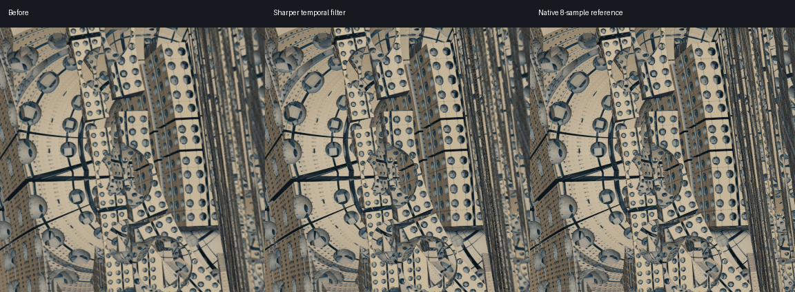

# Sharper detail during flight — 2026-11-03

The temporal filter now retains finer edges during movement and checks that
reprojected history belongs to the same surface. It uses the existing history
textures; GPU memory requirements stay the same.

## Implementation

- Store logarithmic radial depth in the unused alpha channel of each RGBA16F
  history texture. Reject old surface colours when depth or sky classification
  disagrees with the reprojected current surface. Allow for neighbourhood depth
  variation and half-precision rounding.
- Correct depth comparisons for changes in camera units. Reproject in units of
  the hit distance, preserving distant surfaces beyond ordinary float range.
- Use a tighter current-sample reconstruction kernel and a wider colour variance
  box on depth-validated history. The final sharpening strength stays at 0.25.
- Normalize Gaussian weights relative to the closest sample. This prevents dark
  pixels when a large output is reconstructed from a small traced image.
- Scale the jitter sequence from 8 phases at native resolution to approximately
  `8 * (output_height / traced_height)^2`, capped at 64. Balanced 4K uses 32
  positions at its full profile size; dynamic resolution adjusts the count.
- Use a current-frame blend of 0.10 during movement and 0.08 when stationary, so
  stopping retains the previous level of temporal stability.
- Finish the still-frame accumulation when launching into a stationary view,
  including manual flights loaded from a snapshot.

Depth validation and camera jitter are established temporal reconstruction
techniques described in [AMD's temporal upscaling documentation](https://gpuopen.com/manuals/fidelityfx_sdk/techniques/super-resolution-temporal/).
Aurora implements its own filter adapted to its logarithmic fractal coordinates.

## Image comparisons

Fixed 1/60-second steps, matching camera snapshots, speed 3.8, 90 frames, captures
at frames 30, 60 and 89. The turning test uses speed 2 and yaw 0.012 radians per
frame. Ultra and Performance use 60 frames, with captures at 30 and 59.
Dynamic resolution is disabled for these comparisons so both filters receive
the same traced pixel count.

Each capture is compared with the same camera rendered at native output size,
averaging eight jittered raw samples. Reference images must match byte-for-byte
between variants. This is a finite-sample image reference. Edge contrast measures
mean absolute luminance gradients; it is a sharpness proxy, not a geometric
resolution measurement. PSNR checks whether the complete image approaches the
reference, rather than rewarding sharpness alone.

| Scenario | Edge contrast change | PSNR change |
|---|---:|---:|
| 1080p Balanced, three forward routes including the user's current camera | +7–9% | +0.47 to +1.03 dB |
| 1080p Balanced, two turning routes | +7–8% | +0.81 to +0.84 dB |
| 4K Balanced, five forward routes | about +4–5% | about 0 to +0.13 dB |
| 4K Ultra, corner and user's current camera | about +5% | +0.10 to +0.26 dB |
| 4K Performance, corner and root slow view | +6–7% | about 0 to +0.06 dB |

The hardest 4K views remain limited by the traced resolution. In two Balanced
views the gradient error increases by about 0.5% despite higher edge contrast;
their whole-image PSNR is essentially unchanged. Fine detail still benefits
more from a higher traced resolution than from filtering alone.

Stationary 4K tests run 96 frames. Over the last 32 frames, mean per-pixel maximum
RGB-channel change stays effectively unchanged: corner **0.462 → 0.459**, interior
**0.771 → 0.768**, on a 0–255 channel scale. Stationary PSNR improves by approximately
0.10–0.12 dB.



## Performance

RTX 4070 SUPER, Balanced, 3840 × 2160 output, fixed profile resolution and temporal
filter enabled. Three alternating before/after rounds, 64 measured frames per
view, with warmup before measurement:

| View | Previous median of medians | Updated median of medians |
|---|---:|---:|
| corner | 11.64 ms | 11.54 ms |
| interior | 6.76 ms | 6.80 ms |
| root slow | 16.65 ms | 16.41 ms |
| preview slow | 15.19 ms | 15.23 ms |

The sum of best sustained frame times changes from 48.17 to 48.25 ms (+0.2%).
The measurements indicate essentially unchanged GPU cost. These are GPU frame
times, not a measurement of onscreen FPS or input latency.

## Validation and reproduction

- CTest: 4/4 passed. GPU tests cover surface-depth rejection, matching history,
  camera-unit rebasing, radial log depth 200, sky transitions, and a uniform image
  upscaled 8× per axis without darkening.
- Existing `--benchmark`, `--regression`, and `--field-regression` checks pass.
- All 14 unfiltered saved-view PNGs at 1980 × 1058 match the previous build by
  SHA-256. Their unfinished-pixel counts remain zero.
- The comparison script also covers the current user camera, all three profiles,
  turns, and stationary views.

From the repository root, after building:

```powershell
ctest --test-dir Aurora-2026-10-18/build -C Release --output-on-failure
python Aurora-2026-10-18/validation/tools/temporal_quality.py Aurora-2026-10-18/build/Release/AuroraFractal.exe Aurora-2026-10-18/build/validation/temporal-clarity/reproduce --fixtures corner,interior --size 1920x1080 --frames 90 --every 30 --preview interior
```

The script requires NumPy and Pillow. `--temporal-audit` is an offline diagnostic:
native reference rendering and readback are excluded from the recorded GPU times.
Raw image captures, references, metrics and the previous executable are retained
under `build/validation/temporal-clarity/`. `AURORA_TAA_DETAIL=0` restores the prior
filter for A/B checks; `AURORA_TAA_PHASES` is a diagnostic phase-count override.
